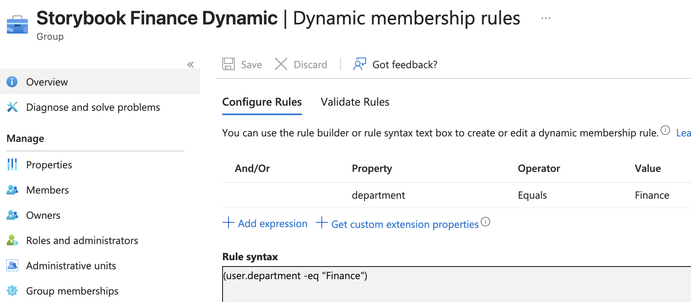
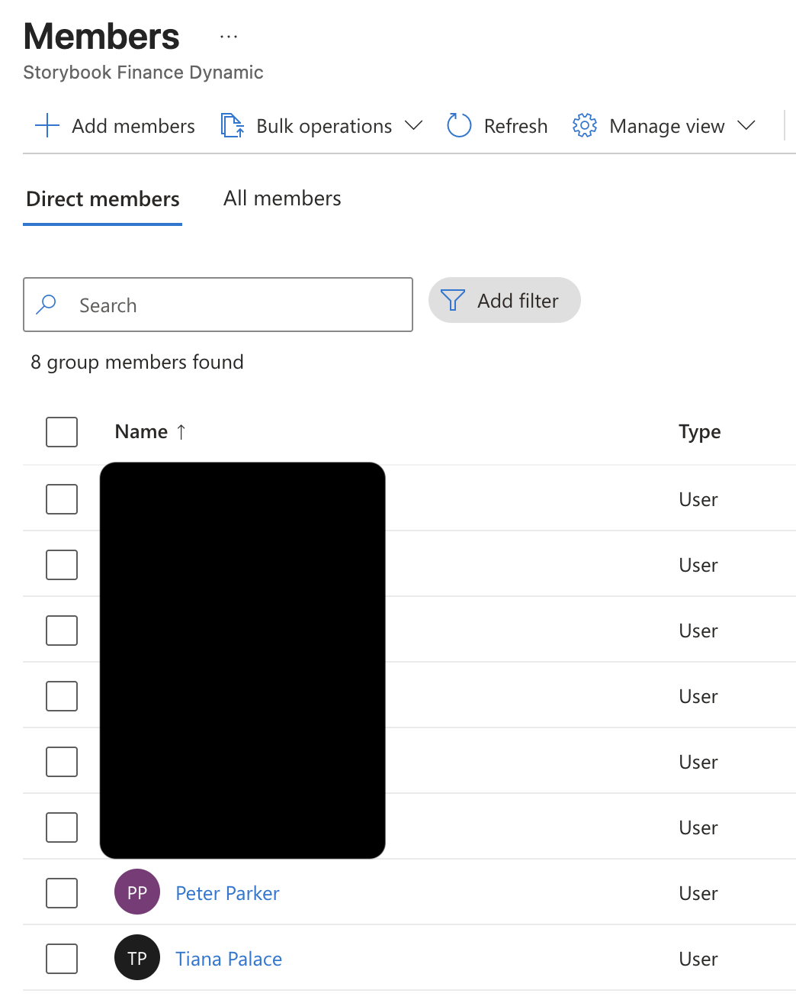
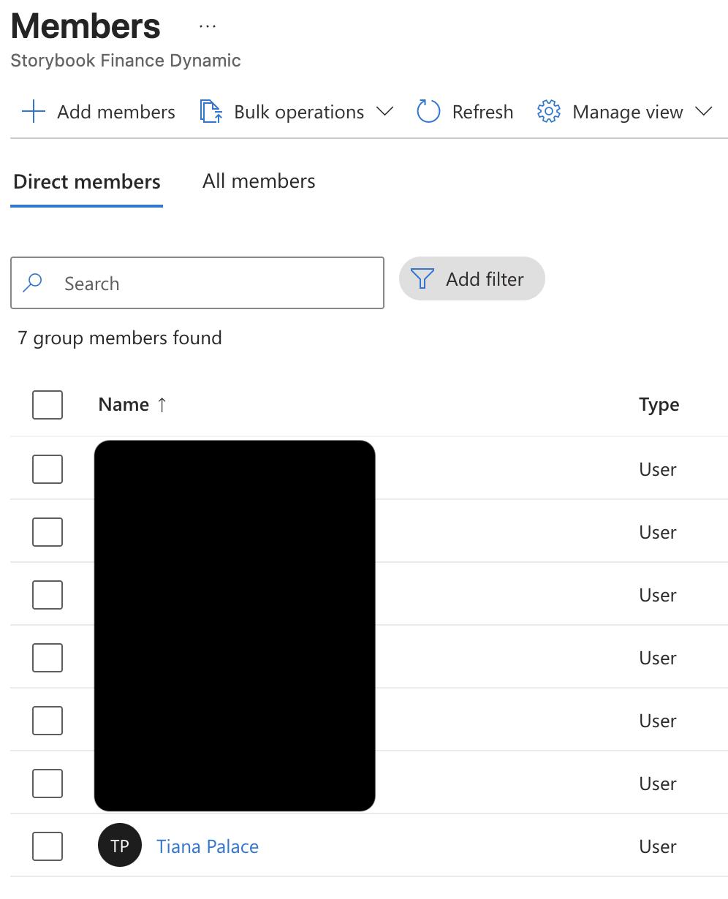
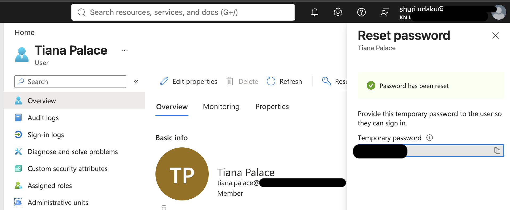
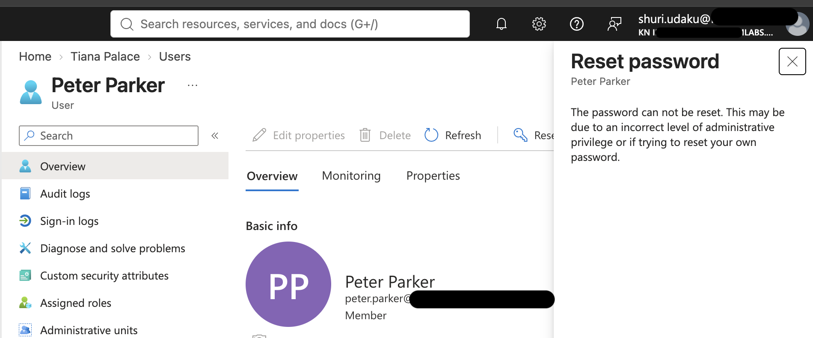

# Storybook-Entra-Identity-Foundation
## Skills Practiced

Microsoft Entra ID lab covering users, groups, dynamic membership, and scoped administration
Storybook Studios Identity Foundation Lab

Overview

I built an employee directory for Storybook Studios, a fictional animation company, using Microsoft Entra ID. The goal was to organize employees, automate department group membership, and delegate a limited administrative task.

What I configured

I created four fictional employees: Tiana Palace in Finance, Shuri Udaku in Technology, Velma Dinkley in Security, and Peter Parker in Creative.

I created assigned security groups for each department and a dynamic Finance group using the Department attribute.

I created a Finance Administrative Unit containing Tiana and assigned Shuri the Password Administrator role within that scope.

What I tested

Changing Peter’s department to Finance automatically added him to the dynamic Finance group. Returning his department to Creative automatically removed him. His manually assigned Creative membership remained unchanged.

Shuri successfully reset Tiana’s password inside the Finance Administrative Unit. Her attempt to reset Peter’s password outside that unit was blocked.

After testing, I removed Shuri’s temporary administrative assignment.

What I learned

Dynamic membership depends on accurate identity attributes. Assigned membership requires separate maintenance when responsibilities change.

Administrative roles define what someone can do. Administrative Unit scope limits which accounts that role applies to.

Testing both permitted and blocked actions helped me verify the configuration. Removing temporary privileges completed the exercise.

Career relevance

This lab developed practical IAM skills in identity administration, membership automation, scoped role assignments, and permission testing.

It also strengthened governance skills in documenting permissions, collecting evidence, and removing privileges when the need ends. These are foundations I can apply when learning AI access governance.

Scope

This was a practice tenant with fictional employees. I tested directory membership and administrative permissions. Application access and AI specific controls were outside this lab.

## Lab Evidence

### Finance membership rule
The group uses the Department attribute to identify Finance employees.

### Automatic membership addition
Peter joined the dynamic Finance group after his department changed to Finance.

### Automatic membership removal
Peter left the dynamic Finance group after his department returned to Creative.

### Permitted administrative action
Shuri successfully reset Tiana’s password within the Finance Administrative Unit.

### Blocked administrative action
Shuri was prevented from resetting Peter’s password outside the Finance Administrative Unit.

